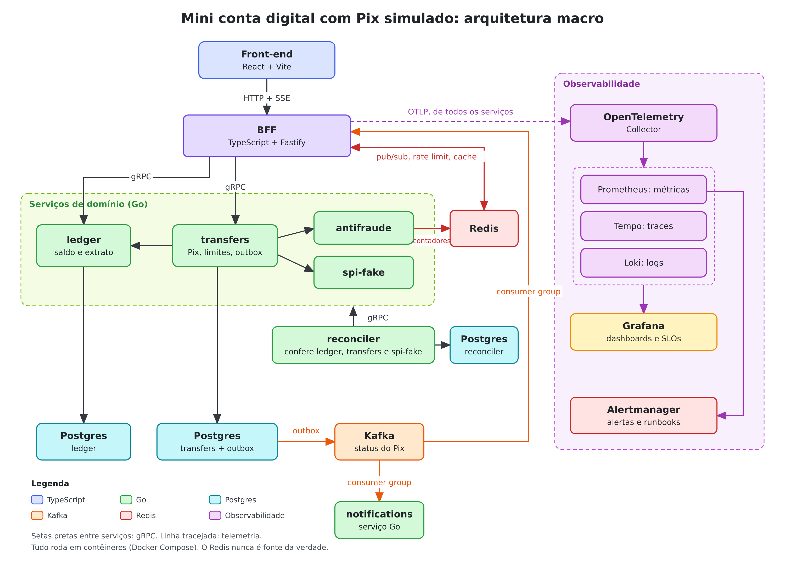
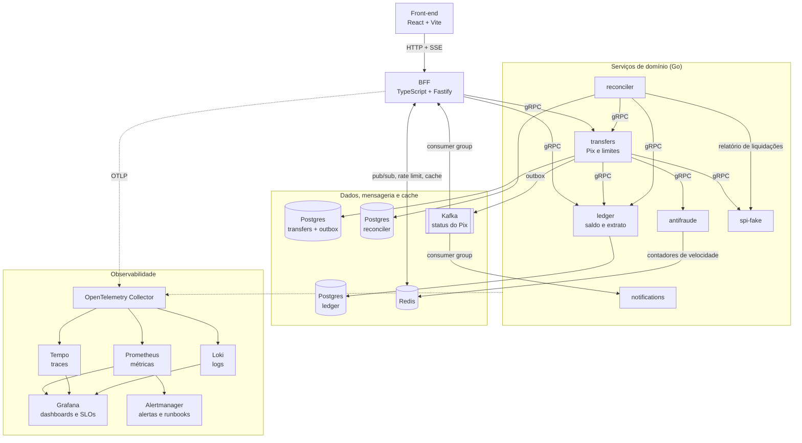
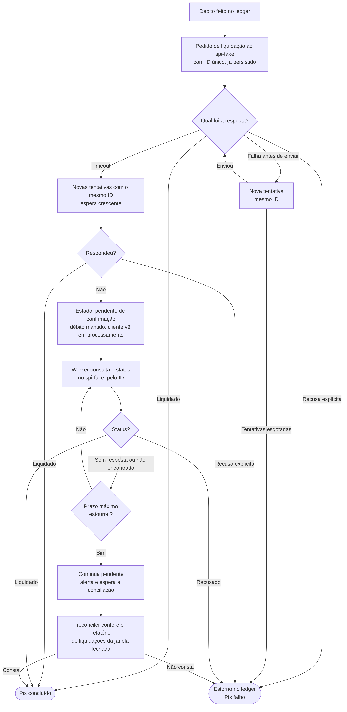

# Arquitetura macro: Mini conta digital com Pix simulado

Diagrama de referência do projeto. Os detalhes de cada peça estão em `plano-conta-digital.md`.

A imagem está no arquivo `arquitetura-conta-digital.png`. O mesmo diagrama segue em Mermaid, como texto:

## Como ler

**Caminho da requisição.** O front-end fala com o BFF por HTTP e SSE. O BFF chama `ledger` e `transfers` por gRPC. O `transfers` orquestra o Pix: consulta o `antifraude`, verifica o limite, valida a conta e debita no `ledger`, e liquida no `spi-fake`.

**Caminho dos eventos.** O `transfers` grava cada mudança de status no outbox, na mesma transação do banco, e um relay publica no Kafka. O tópico tem dois consumer groups: o do `notifications` e o do BFF.

**Tempo real.** As instâncias do BFF dividem um único consumer group. A instância que recebe um evento o republica em um canal do Redis, e só a instância que tem o cliente conectado, inscrita nesse canal, o repassa ao navegador por SSE. A cada conexão, o cliente recebe primeiro o estado atual do Pix, o que cobre mensagens perdidas pelo pub/sub.

**Conciliação.** O `reconciler` roda por janela de tempo e compara o `transfers` com o `ledger` e com o relatório de liquidações do `spi-fake`, sempre pelas APIs de cada serviço. As divergências ficam registradas no banco dele.

**Observabilidade.** Todos os serviços exportam logs, métricas e traces por OTLP para o Collector, que distribui para Prometheus, Tempo e Loki. O Grafana lê os três. O Prometheus avalia as regras de alerta e aciona o Alertmanager.

## Peças

| Peça | Linguagem | Papel |
|---|---|---|
| Front-end | TypeScript (React, Vite) | Telas de home e de Pix, com status em tempo real |
| BFF | TypeScript (Fastify) | Agrega chamadas, molda a resposta para cada tela, mantém o stream SSE |
| ledger | Go | Contas, saldo e lançamentos em partida dobrada |
| transfers | Go | Orquestra o Pix como saga; dono dos limites e do outbox |
| antifraude | Go | Score a partir de contadores de velocidade, com latência e falhas configuráveis |
| spi-fake | Go | Liquidação simulada, com latência e falhas configuráveis; gera o relatório de liquidações |
| notifications | Go | Consome os eventos de status e simula o envio de notificações |
| reconciler | Go | Compara `transfers` com `ledger` e com o `spi-fake`, e registra as divergências |
| Postgres | | Um banco por serviço (`ledger`, `transfers` e `reconciler`); única fonte da verdade |
| Kafka | | Log particionado com os eventos de status do Pix |
| Redis | | Estado compartilhado que pode ser perdido sem prejuízo |

## Usos do Redis

| Uso | Onde | Fase |
|---|---|---|
| Contadores de velocidade | `antifraude` | 3 |
| Pub/sub do tempo real | BFF | 4 |
| Rate limit distribuído | BFF | 6 |
| Cache-aside da home (extrato e limites; o saldo nunca é cacheado) | BFF | 7 |

O Redis nunca é fonte da verdade. Saldo, idempotência das escritas e estado da saga ficam no Postgres, em transação.

## Fluxo de timeout na liquidação

Quando o `transfers` pede a liquidação ao `spi-fake` e não recebe resposta, o Pix não é concluído nem estornado: fica pendente de confirmação, um worker dentro do `transfers` consulta o status pelo ID e, passado o prazo máximo, a conciliação decide. As regras e o fluxo em texto estão na seção 4.5 de `plano-conta-digital.md`.

## Fora do diagrama

- **Ambiente**: tudo roda em contêineres, via Docker Compose. O k6 gera a carga pelo BFF.
- **Fase 8 (opcional)**: o mesmo sistema em Kubernetes (k3s), com HPA e KEDA.
- **Detalhes de fase**: tópico de dead-letter, proxy reverso para as simulações com réplicas e a interface web do Kafka.
