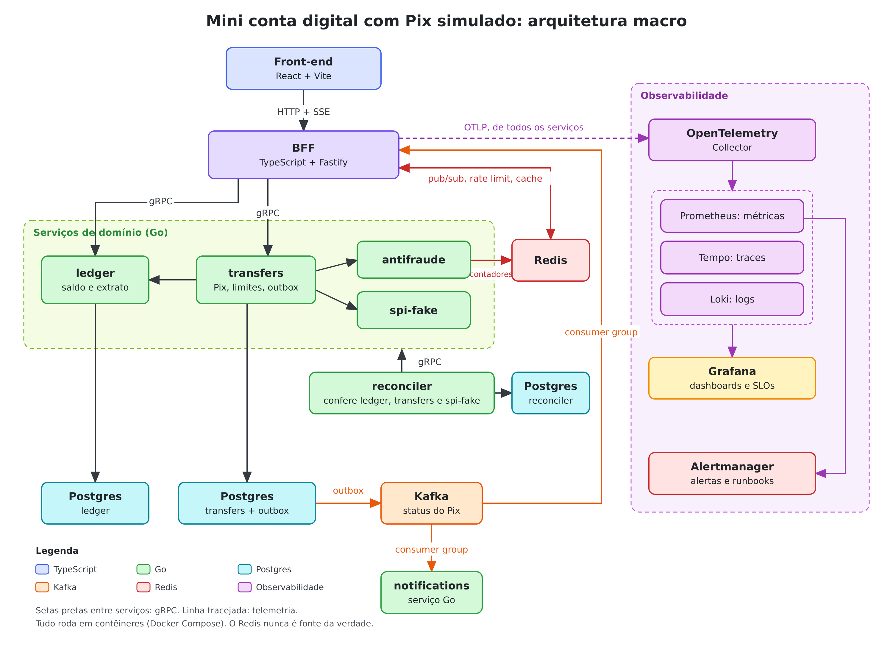
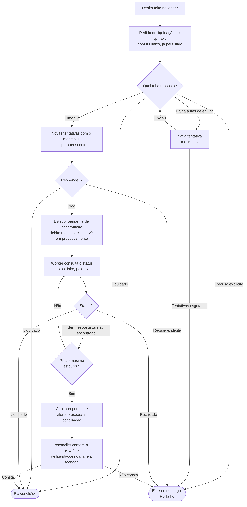
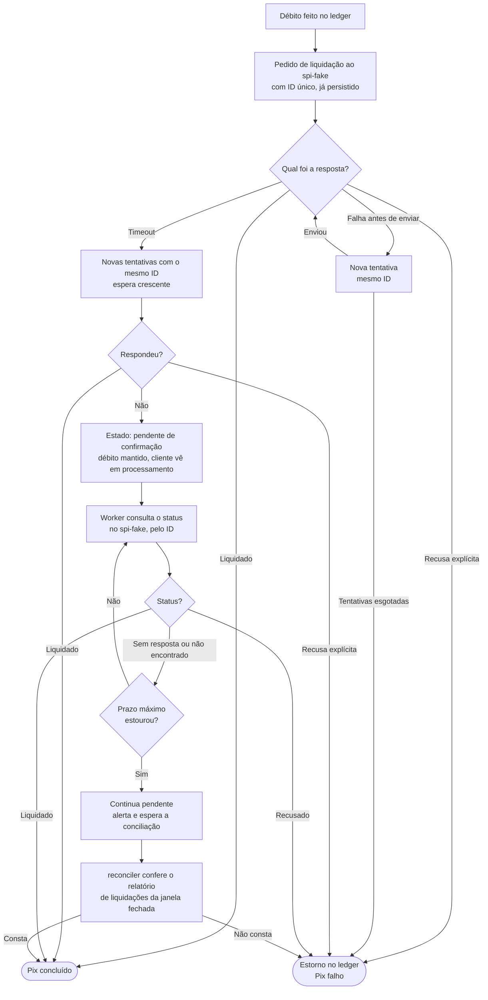

# Plano: Mini conta digital com Pix simulado

Projeto didático para aprender, na prática, uma stack comum em fintechs: **Go nos serviços de domínio** e **TypeScript/Node no BFF**, usando padrões de mercado nas duas linguagens, com observabilidade e monitoramento desde a primeira fase.

## 1. Objetivo

Construir, em fases, uma conta digital pequena com Pix simulado, de forma que cada fase:

- termine com algo rodando e observável;
- ensine padrões de projeto específicos de cada linguagem;
- tenha um critério de pronto verificável;
- tenha um prompt próprio e um modelo recomendado para construí-la.

Ao final, o projeto deve permitir simulações de carga em várias escalas e reagir a elas por meio de gatilhos baseados em métricas.

## 2. Arquitetura



O mesmo desenho, em texto:

```
Web SPA ──> BFF (TypeScript, Fastify)
  HTTP + SSE  │  gRPC, tipos gerados do .proto
              ├──> ledger (Go, Postgres)      contas, saldo, lançamentos
              └──> transfers (Go, Postgres)   orquestra o Pix, dono dos limites
                      ├──> ledger             valida conta, debita, estorna
                      ├──> antifraude (Go)    score a partir de contadores no Redis
                      └──> spi-fake (Go)      liquidação simulada

transfers ──outbox──> Kafka (eventos de status do Pix)
                        ├──> BFF ──> Redis pub/sub ──> instância com o cliente ──> SSE
                        └──> notifications (Go)   consumer group, notificação simulada

reconciler (Go, Postgres) ──gRPC──> transfers, ledger e spi-fake   conciliação por janela

Redis: contadores do antifraude; pub/sub do tempo real, rate limit e cache no BFF

Todos os serviços ──OTLP──> OpenTelemetry Collector
                               ├──> Prometheus (métricas) ──> Alertmanager
                               ├──> Tempo (traces)
                               └──> Loki (logs)
                            Grafana lê os três
```

| Peça | Responsabilidade | Vantagem da stack que aparece |
|---|---|---|
| **Front-end** (React, Vite) | Telas mínimas de home e de Pix, com o status mudando em tempo real | Mesma linguagem do BFF, com tipos gerados do contrato dele |
| **ledger** (Go) | Partida dobrada, saldo e idempotência em transação no Postgres | Código explícito e auditável; binário pequeno |
| **transfers** (Go) | Recebe o Pix; consulta o antifraude, verifica o limite diário e valida a conta de destino em paralelo; debita e liquida. É dono dos limites | Goroutines, `context` com timeout e cancelamento |
| **antifraude** (Go) | Devolve score a partir de contadores de velocidade no Redis, com latência e falhas configuráveis | Alvo para testes de resiliência e carga |
| **spi-fake** (Go) | Simula a liquidação no SPI, com latência e falhas configuráveis; oferece consulta de status e gera o relatório de liquidações | Permite testar compensação, estorno, timeout e conciliação |
| **BFF** (TS) | Agrega chamadas e molda a resposta para cada tela; SSE de status | Agregação de I/O, tipos compartilhados com o front, mudança rápida |
| **Eventos** (Kafka) | Log particionado com os eventos de status do Pix, lido por consumer groups | Desacopla o Pix da entrega do status; permite ordenação por chave, replay e medição de lag |
| **Redis** | Contadores de velocidade do antifraude; pub/sub do tempo real, rate limit e cache no BFF | Estado compartilhado entre réplicas, sem ser fonte da verdade |
| **notifications** (Go) | Consome os eventos de status em consumer group e simula o envio de notificações, com lentidão configurável | Consumidor que escala horizontalmente; gera lag e dead-letter observáveis |
| **reconciler** (Go) | Job que compara `transfers` com `ledger` e com o relatório do `spi-fake`, e registra as divergências | Processamento em lote com worker pool e leitura em streaming |
| **Contratos** | `.proto` gerando Go e TS entre os serviços; OpenAPI do BFF gerando os tipos do front | Fronteiras tipadas de ponta a ponta |

## 3. Regras do projeto

1. **Regra de negócio fica só nos serviços Go.** O BFF agrega, adapta e protege, mas não calcula saldo, limite nem tarifa.
2. **Dinheiro é inteiro em centavos** (`int64`), nunca ponto flutuante.
3. **Contrato primeiro**: toda comunicação entre serviços nasce no `.proto`; o código Go e TS é gerado dele. Entre o front e o BFF, o contrato é o OpenAPI gerado dos schemas do BFF, e os tipos do front são gerados dele.
4. **Toda escrita é idempotente**, com chave de idempotência vinda do cliente.
5. **Cada decisão relevante vira um ADR** curto em `docs/adr/` (contexto, decisão, consequências).
6. **Nada entra sem lint, teste e CI verdes.**
7. **Observabilidade faz parte do pronto**: nenhum endpoint, chamada externa ou consumidor de eventos entra sem log estruturado, métrica e span de trace.
8. **Tudo roda em contêiner**: serviços, banco de dados, mensageria (Kafka), Redis, observabilidade, testes de carga e também as ferramentas de desenvolvimento. A máquina só precisa de Docker (ver seção 4.1).
9. **O Redis nunca é fonte da verdade**: saldo, idempotência das escritas e estado da saga ficam no Postgres, em transação. Se o Redis cair ou perder dados, o sistema pode ficar mais lento ou menos protegido, mas não perde dinheiro nem registra nada errado (ver seção 4.3).
10. **Timeout na liquidação não é falha**: sem confirmação do SPI, o Pix não é concluído nem estornado; fica pendente até a consulta de status ou a conciliação decidirem (ver seção 4.5).

## 4. Estrutura do repositório

```
conta-digital/
├── compose.yaml              ponto de entrada; inclui os arquivos de deploy/compose/
├── Makefile                  tarefas executadas dentro do contêiner tools
├── proto/                    contratos (buf)
├── services/
│   ├── ledger/               Go, um módulo por serviço (go.work na raiz)
│   │   ├── cmd/ledger/main.go      composition root
│   │   ├── internal/
│   │   │   ├── account/      domínio e casos de uso
│   │   │   ├── postgres/     repositórios (sqlc + pgx)
│   │   │   ├── grpcapi/      handlers e mapeamento de erros
│   │   │   └── platform/     config, log, telemetria
│   │   └── migrations/
│   ├── transfers/
│   ├── antifraude/
│   ├── spi-fake/             simulador de liquidação
│   ├── reconciler/           job de conciliação
│   └── notifications/        consumidor Kafka em consumer group
├── bff/                      TypeScript
│   └── src/
│       ├── app.ts            composition root
│       ├── modules/home/     route, schema, service, mapper
│       ├── modules/pix/
│       ├── clients/          adaptadores gRPC
│       └── plugins/          auth, erros, telemetria
├── web/                      front-end de demonstração (React + Vite)
├── tools/                    Dockerfile da imagem de ferramentas
├── .devcontainer/            opcional: editor rodando dentro do contêiner
├── load/                     roteiros k6
├── deploy/
│   ├── compose/              arquivos do compose por grupo (core, events, obs, load)
│   ├── otel/                 configuração do Collector
│   ├── prometheus/           scrape, regras de alerta e de gravação
│   ├── alertmanager/
│   └── grafana/              dashboards e datasources como código
└── docs/
    ├── adr/
    └── runbooks/             um por alerta
```

### 4.1 Ambiente 100% em contêineres

Pré-requisito na máquina: apenas **Docker** com o plugin Compose (e Git, para versionar). Go, Node, pnpm, buf, sqlc, linters, k6, Postgres, Kafka, Redis e a stack de observabilidade rodam em contêineres. Nada disso é instalado localmente.

| Item | Como roda |
|---|---|
| **Ferramentas de desenvolvimento** | Imagem `tools` com Go, Node, pnpm, buf, sqlc, golangci-lint, ferramenta de migrations, grpcurl, psql e redis-cli, usada com `docker compose run --rm tools <comando>` |
| **Tarefas** | Makefile executado dentro do contêiner `tools`, para lint, testes, geração de código, migrations e seed (não exige `make` na máquina) |
| **Ciclo de vida** | Subir, parar e apagar o ambiente são comandos diretos do Compose (`docker compose up -d`, `docker compose down`, `docker compose down -v`), porque o contêiner `tools` não controla o Docker |
| **Serviços Go e BFF** | Contêineres com o código montado por volume e recarga automática (`air` no Go, `tsx watch` no TS) |
| **Front-end** | Servidor de desenvolvimento do Vite em contêiner, com recarga automática e proxy para o BFF; acessado pelo navegador da máquina |
| **Banco de dados** | Postgres em contêiner, um banco por serviço, dados em volume nomeado |
| **Mensageria** | Kafka em modo KRaft (sem ZooKeeper), um broker, dados em volume nomeado; tópicos criados por script versionado; interface web opcional para inspecionar tópicos e consumer groups |
| **Redis** | Uma instância em contêiner, a partir da fase 3, com limite de memória e política de descarte explícitos |
| **Observabilidade** | Collector, Prometheus, Alertmanager, Tempo, Loki e Grafana em contêineres |
| **Testes de carga** | Imagem oficial do k6 |
| **Testes de integração** | Postgres, Kafka e Redis reais em contêiner; a estratégia é decidida no ADR-0003 (Testcontainers com o socket do Docker montado no contêiner `tools`, ou serviços de teste dedicados no compose) e vale para as três dependências |
| **CI** | Mesmas imagens e mesmos comandos do ambiente local |
| **Editor** | Opcional: `.devcontainer/` para o editor rodar dentro do contêiner `tools`, com autocompletar e lint sem instalar as linguagens |

Práticas adotadas:

- Versões de imagem fixadas, nunca `latest`.
- Healthcheck em todo contêiner e `depends_on` com condição de saúde, para a ordem de subida ser confiável.
- Profiles do Compose (`core`, `events`, `obs`, `load`) para subir só o necessário em cada momento. O Kafka fica no profile `events` e só é necessário a partir da fase 4.
- Imagens finais mínimas e sem usuário root (distroless nos serviços Go), separadas das imagens de desenvolvimento.
- Configuração por variáveis de ambiente, com `.env.example` versionado.
- Dados em volumes nomeados; `docker compose down -v` apaga tudo, para recriar do zero.

A stack completa consome bastante memória, e o Kafka é uma das peças mais pesadas. Reserve pelo menos 8 GB para o Docker; em máquinas menores, suba a observabilidade só quando for usá-la, pelo profile `obs`.

### 4.2 Mensageria com Kafka

| Tema | Prática |
|---|---|
| **Broker** | Modo KRaft, um broker e fator de replicação 1 no ambiente local; o ADR explica o que muda em produção (três brokers ou mais, réplicas e `min.insync.replicas`) |
| **Tópicos** | Criados por script versionado, nunca automaticamente; nomes no padrão `dominio.entidade.evento` (por exemplo, `pix.transfer.status-changed`); 6 partições, para haver o que observar |
| **Chave** | ID da transferência, o que garante a ordem dos eventos de um mesmo Pix |
| **Payload** | Protobuf, vindo do diretório `proto/`; Schema Registry é discutido no ADR e fica fora do escopo inicial |
| **Produtor** | Idempotente, com `acks=all`; só o relay do outbox publica |
| **Consumidor** | O serviço `notifications`, em consumer group compartilhado entre as réplicas, com commit de offset só depois de processar; idempotente; mensagens que falham repetidamente vão para um tópico de dead-letter |
| **BFF** | As instâncias dividem um único consumer group. Quem recebe o evento o republica em um canal do Redis (seção 4.3), e só a instância que tem o cliente conectado o repassa por SSE. A cada conexão ou reconexão, o cliente recebe primeiro o estado atual do Pix, consultado no `transfers`, e depois os eventos ao vivo |
| **Bibliotecas** | Escolhidas no ADR da fase 4, comparando as opções em Go e em Node e conferindo a manutenção atual de cada uma |
| **Métricas** | Lag por consumer group e partição, rebalanceamentos, taxa de produção e de consumo, mensagens no dead-letter |

### 4.3 Redis

O Redis guarda estado compartilhado entre réplicas que pode ser perdido sem prejuízo. Nunca é fonte da verdade (regra 9).

| Uso | Onde | Como | Fase |
|---|---|---|---|
| **Contadores de velocidade** | `antifraude` (Go) | Quantidade e valor de Pix por conta em uma janela de tempo, com incremento atômico e expiração | 3 |
| **Pub/sub do tempo real** | BFF | Um canal por Pix: a instância que consome o evento do Kafka publica, e a instância com o cliente conectado assina | 4 |
| **Rate limit distribuído** | BFF | Contador por cliente, compartilhado entre as réplicas | 6 |
| **Cache-aside da home** | BFF | Extrato e limites com TTL curto e invalidação pelos eventos de status do Pix; o saldo nunca é cacheado | 7 |

Práticas adotadas:

- Uma instância, sem cluster, com limite de memória e política de descarte explícitos. A política é decidida em ADR, porque cache e contadores dividem a mesma instância.
- Toda chave tem prefixo por uso (`af:`, `rl:`, `cache:`) e expiração.
- Timeout curto em todo comando. O comportamento com o Redis fora do ar é decidido em ADR para cada uso.
- Biblioteca cliente escolhida em ADR: a de Go na fase 3 e a de Node na fase 4.
- Métricas: latência dos comandos, memória usada, chaves descartadas, taxa de acerto do cache e recusas do rate limit.

### 4.4 Conciliação

A conciliação confere, depois do fato, se os sistemas fecharam entre si. Ela não substitui idempotência, saga e outbox: cobre o que esses mecanismos não garantem sozinhos, como o timeout ambíguo na liquidação, em que o `transfers` não sabe se o SPI liquidou ou não.

| Conciliação | Compara | Divergências procuradas |
|---|---|---|
| **Interna** | `transfers` com `ledger` | Pix liquidado sem débito; estorno sem crédito; soma de débitos diferente da soma de créditos |
| **Externa** | `transfers` com o relatório de liquidações do `spi-fake` | Liquidado no SPI e falho aqui, ou o contrário; valor diferente; Pix presente só de um lado |

Práticas adotadas:

- O `reconciler` lê os dados pelas APIs gRPC de cada dono, em streaming, nunca direto no banco de outro serviço.
- Roda por janela de tempo fechada, com atraso de tolerância, para não acusar Pix ainda em andamento. Reexecutar a mesma janela dá o mesmo resultado.
- Executa por agendamento interno configurável e também sob demanda.
- Cada divergência é registrada no banco do `reconciler`, com tipo, valores dos dois lados e estado (aberta, resolvida, ignorada).
- Correção automática só nos casos seguros e idempotentes, definidos em ADR, e sempre pela API do dono do dado. O resto fica como pendência para análise.
- O `spi-fake` gera o relatório de liquidações e injeta divergências de propósito, por configuração.
- Métricas: divergências por tipo, divergências abertas, idade da mais antiga, duração e volume de cada execução.

### 4.5 Timeout na liquidação

Timeout não é falha, é desconhecimento: o `transfers` não sabe se o SPI liquidou. Enquanto houver dúvida, o débito é mantido e o Pix não é concluído nem estornado (regra 10).

| O que aconteceu | O que se sabe | O que fazer |
|---|---|---|
| **Recusa explícita** do SPI | Não liquidou | Estornar o débito |
| **Falha antes de enviar** (conexão recusada) | Não liquidou | Tentar de novo com o mesmo ID; esgotadas as tentativas, estornar |
| **Timeout depois de enviar** | Nada | Seguir o fluxo abaixo |



O mesmo fluxo, em texto:



Práticas adotadas:

- O ID da liquidação é gerado pelo `transfers` e persistido antes da chamada. Toda nova tentativa usa o mesmo ID, nunca um novo.
- O `spi-fake` é idempotente por ID e oferece consulta de status da liquidação.
- "Pendente de confirmação" é um estado da máquina de estados da saga. O débito continua feito e o cliente vê o Pix como em processamento.
- O worker de confirmação roda dentro do `transfers` e lê os pendentes do banco, então sobrevive a um reinício do processo. Intervalo das consultas e prazo máximo são configuráveis.
- "Não encontrado" na consulta não prova que não liquidou, porque o pedido pode ainda estar em trânsito. Só a conciliação da janela fechada decide esse caso.
- Passado o prazo máximo, o Pix continua pendente, gera alerta (fase 6) e é fechado pela conciliação (fase 5). Até a fase 5 existir, esses casos ficam pendentes e visíveis no dashboard.
- Nunca: estornar por timeout, concluir sem confirmação ou reenviar com outro ID.
- Métricas: timeouts de liquidação, Pix pendentes de confirmação, idade do mais antigo e resultado das consultas de status.

## 5. Padrões de mercado em Go

| Tema | Prática |
|---|---|
| Organização | `cmd/` + `internal/`, pacotes por domínio (não `models/`, `controllers/`) |
| Arquitetura | Portas e adaptadores enxuto: interfaces pequenas, definidas por quem consome; "aceite interfaces, retorne structs" |
| Dependências | Injeção por construtor, montada à mão no `main`, sem framework de DI |
| Configuração | Variáveis de ambiente validadas no boot; *functional options* para construtores |
| Erros | Wrapping com `%w`, `errors.Is/As`, erros de domínio tipados e traduzidos para status gRPC só na borda |
| Contexto | `context.Context` como primeiro parâmetro, com timeout e cancelamento propagados |
| Concorrência | `errgroup` para fan-out, worker pool, graceful shutdown com `signal.NotifyContext` |
| Dados | `sqlc` + `pgx`, migrations versionadas, transação via função `WithTx` |
| Transversais | Interceptors gRPC (logging, métricas, tracing, recuperação de panic), `slog` estruturado, OpenTelemetry |
| Testes | Table-driven, `-race`, integração contra Postgres, Kafka e Redis reais em contêiner |
| Ferramentas | `gofmt`, `golangci-lint`, `govulncheck`, `buf` |

## 6. Padrões de mercado em TypeScript

| Tema | Prática |
|---|---|
| Base | `strict` e `noUncheckedIndexedAccess` ligados, ESM, pnpm, ESLint + Prettier |
| Framework | Fastify com plugins encapsulados |
| Organização | Por feature (`modules/home`), cada uma com rota, schema, serviço e mapper |
| Borda | Validação de entrada e saída com Zod, tipos inferidos do schema, OpenAPI gerado |
| Dependências | Factory functions e composition root em `app.ts`, sem contêiner pesado |
| Downstream | Um adaptador por serviço em `clients/`, sobre o cliente gRPC gerado; o resto do código não conhece gRPC |
| Agregação | `Promise.allSettled`, timeouts com `AbortSignal`, degradação parcial explícita |
| Erros | Uniões discriminadas para erros esperados, handler central que traduz para HTTP |
| Modelagem | Mapper de resposta de domínio para *view model* da tela |
| Transversais | `pino`, OpenTelemetry, propagação de correlation ID e deadline, graceful shutdown |
| Testes | Vitest, `fastify.inject`, servidores gRPC falsos para simular downstream |

### 6.1 Front-end de demonstração

Um front-end pequeno, para ver o sistema funcionando no navegador, em especial o status do Pix mudando em tempo real. Não é o foco do projeto e deve continuar pequeno.

| Tema | Prática |
|---|---|
| Stack | React + Vite + TypeScript com `strict`, em contêiner |
| Contrato | Tipos e cliente HTTP gerados do OpenAPI do BFF; nenhum tipo de resposta escrito à mão |
| Acesso ao BFF | Proxy do Vite em desenvolvimento, para evitar CORS |
| Tempo real | SSE com reconexão automática; a cada conexão o BFF envia o estado atual do Pix e depois os eventos ao vivo, e o `Last-Event-ID` serve para descartar repetidos |
| Autenticação | Login de demonstração: o BFF emite o JWT para usuários do seed, só em ambiente de desenvolvimento; a forma de autenticar o stream SSE é decidida em ADR |
| Escopo | Sem design system, sem gerenciador de estado global e sem regra de negócio: o front só exibe o que o BFF devolve |
| Testes | Poucos: um por tela, cobrindo o estado principal (Vitest e Testing Library); sem testes de ponta a ponta |

| Tela | Fase | O que mostra |
|---|---|---|
| **Home** | 2 | Saldo e últimas transações, com aviso no lugar do extrato quando a resposta vem degradada; os limites entram na fase 3 |
| **Novo Pix** | 4 | Formulário de envio, com chave de idempotência gerada no cliente |
| **Acompanhar Pix** | 4 | Linha do tempo que avança sozinha a cada evento, indicador de conexão e painel com os eventos brutos recebidos |

## 7. Observabilidade e monitoramento

Observabilidade não é uma fase isolada: cada fase instrumenta o que constrói. A fase 6 consolida SLOs, alertas e gatilhos.

### 7.1 Os três sinais

| Sinal | Go | TypeScript | Destino |
|---|---|---|---|
| **Logs** | `slog` em JSON | `pino` em JSON | Loki |
| **Métricas** | SDK do OpenTelemetry | SDK do OpenTelemetry | Prometheus |
| **Traces** | Interceptors gRPC, instrumentação do `pgx`, do cliente Kafka e do cliente Redis | Instrumentação de HTTP, do cliente gRPC, do cliente Kafka e do cliente Redis | Tempo |

Todos os serviços exportam por OTLP para o OpenTelemetry Collector, que distribui para os backends. Trocar um backend não exige mudar código.

### 7.2 Convenções

- **Correlação**: contexto de trace no padrão W3C (`traceparent`) propagado do BFF até o Postgres e pelos eventos do Kafka, nos headers das mensagens. Todo log carrega `trace_id` e `span_id`, para saltar do log ao trace no Grafana.
- **Métricas de requisição**: método RED (taxa, erros, duração) em todo endpoint HTTP e gRPC, com histogramas de latência.
- **Métricas de recurso**: método USE (utilização, saturação, erros) para pool de conexões, goroutines, heap e event loop.
- **Métricas de negócio**: Pix por status, compensações, conflitos de idempotência, valor movimentado, divergências de conciliação.
- **Cardinalidade**: labels só com valores de conjunto pequeno e fixo (serviço, rota, status, dependência). Nunca ID de conta, de transação ou de usuário em label de métrica; esses vão em atributos de trace e campos de log.
- **Dados sensíveis**: nada de CPF, chave Pix completa ou token em logs e traces; mascarar na origem.
- **Saúde**: `/healthz` (processo vivo) e `/readyz` (dependências prontas) em todos os serviços.
- **Tudo como código**: dashboards, regras de alerta e datasources versionados em `deploy/`.

### 7.3 SLIs e SLOs

Valores didáticos, com janelas curtas para que os alertas disparem durante as simulações.

| Jornada | SLI | SLO |
|---|---|---|
| Abrir a home | `GET /home` sem erro 5xx e em menos de 300 ms | 99,5% |
| Iniciar um Pix | `POST /pix` aceito sem erro 5xx | 99,9% |
| Concluir um Pix | Pix liquidado ou estornado em menos de 2 s | 99% |
| Acompanhar o status | Evento entregue ao cliente em menos de 1 s após a mudança | 99% |

### 7.4 Gatilhos baseados em métricas

| Gatilho | Métrica | Condição (exemplo) | Ação | Fase |
|---|---|---|---|---|
| **Gate de desempenho** | Thresholds do k6 | p99 acima do limite ou erro acima de 1% | Teste falha e quebra o CI | 1 e 7 |
| **Backpressure pelo outbox** | Idade do item mais antigo e tamanho da fila do outbox | Acima do limite por 1 minuto | `transfers` reduz a aceitação de novos Pix | 4 |
| **Alerta de lag** | Lag do consumer group do `notifications` | Lag crescendo por alguns minutos | Alertmanager notifica | 6 |
| **Alerta de Pix pendente** | Pix pendentes de confirmação e idade do mais antigo | Pendente além do prazo máximo | Alertmanager notifica, com link para o runbook | 6 |
| **Alerta de conciliação** | Divergências abertas e idade da mais antiga | Divergência aberta além do prazo | Alertmanager notifica, com link para o runbook | 6 |
| **Alerta por SLO** | Burn rate do orçamento de erro, em duas janelas | Consumo acelerado do orçamento | Alertmanager notifica, com link para o runbook | 6 |
| **Load shedding no BFF** | Atraso do event loop e uso de heap | Acima do limite configurado | BFF responde 503 com `Retry-After` (`@fastify/under-pressure`) | 6 |
| **Alerta de dependência** | Estado do circuit breaker e taxa de erro por dependência | Circuito aberto por mais de 1 minuto | Alertmanager notifica | 6 |
| **Autoscaling** | CPU e requisições por segundo (BFF e serviços Go); lag do consumer group (`notifications`) | Acima do alvo por réplica | Sobe e desce réplicas (HPA e KEDA) | 8 |

Cada alerta tem um runbook em `docs/runbooks/` com: o que significa, como confirmar no Grafana, causas prováveis e o que fazer.

## 8. Fases

### Como usar os prompts

- Abra **uma conversa nova por fase**, dentro do projeto, com o modelo indicado.
- Os modelos indicados são os disponíveis em novembro de 2026. O projeto inteiro pode ser feito com Claude Opus 5.5 e Claude Sonnet 5.5; nenhuma fase exige o Claude Fable 5.2.
- O Fable 5.2 é um reforço opcional para as fases 1, 3, 4, 5 e 7: vale recorrer a ele se a fase travar, por exemplo se um teste de concorrência continuar falhando depois de duas ou três tentativas de correção.
- A partir da fase 1, antes de começar, adicione ao conhecimento do projeto a versão mais recente de `estado-do-projeto.md` (gerado ao final da fase anterior), porque uma conversa nova não conhece o código já escrito.
- Critério de escolha do modelo: fases com raciocínio delicado sobre concorrência, consistência e falhas usam o Opus 5.5; fases de estrutura e código mais direto funcionam bem com o Sonnet 5.5. A indicação é um julgamento sobre a dificuldade de cada fase, não um resultado medido.

---

### Fase 0: Fundação

- **Modelo recomendado**: Claude Sonnet 5.5. É montagem de estrutura e ferramentas, com pouca ambiguidade de design.
- **Entrega**: monorepo, `go.work`, pnpm, pipeline do `buf` gerando Go e TS, imagem `tools` e ambiente 100% em contêineres (seção 4.1), Makefile executado dentro do contêiner, Dockerfiles multi-stage, compose com Postgres, CI.
- **Ensina**: tooling padrão das duas stacks, composition root, ADR.
- **Observabilidade**: Collector, Prometheus, Tempo, Loki e Grafana no compose; pacote `platform` (Go) e plugin de telemetria (TS) com log estruturado, `/healthz`, `/readyz` e exportação OTLP; primeiro dashboard provisionado como código.
- **Pronto quando**: em uma máquina só com Docker, `docker compose run --rm tools make lint test` passa nas duas stacks, um "ping" gRPC vai do BFF ao Go e aparece como um trace único no Grafana.

**Prompt**

```text
Vamos executar a Fase 0 (Fundação) do plano-conta-digital.md. Siga as instruções do projeto.

Objetivo: deixar o monorepo pronto para as próximas fases, com as duas stacks
compilando, testando e emitindo telemetria.

Entregas:
- Estrutura de pastas da seção 4 do plano, com go.work e workspace pnpm.
- Pipeline do buf gerando código Go e TypeScript a partir de um .proto de ping.
- Serviço Go mínimo (ledger, só com o ping) e BFF Fastify mínimo chamando esse ping.
- Ambiente 100% em contêineres, conforme a seção 4.1: não tenho Go, Node nem
  nenhuma ferramenta instalada, só Docker. Imagem tools com todas as ferramentas,
  código montado por volume e recarga automática nos serviços.
- Makefile com alvos lint, test e generate, executado dentro do contêiner tools.
  Subir, parar e apagar o ambiente ficam como comandos diretos do docker compose,
  documentados no README, porque o contêiner tools não controla o Docker.
- compose.yaml na raiz, incluindo os arquivos de deploy/compose/.
- Dockerfiles multi-stage (desenvolvimento e imagem final mínima, sem root) e
  docker compose com Postgres, healthchecks, profiles e versões de imagem fixadas.
- .devcontainer opcional para o editor rodar dentro do contêiner.
- CI rodando lint e testes das duas stacks.
- Base de observabilidade da seção 7: Collector, Prometheus, Tempo, Loki e Grafana
  no compose; log estruturado, /healthz, /readyz e exportação OTLP nos dois
  serviços; um dashboard inicial provisionado como código.

Comece pelo ADR-0001 (monorepo e contrato primeiro), pelo ADR-0002 (stack de
observabilidade) e pelo ADR-0003 (ambiente em contêineres, incluindo como os
testes de integração acessam dependências reais: Testcontainers com o socket do
Docker montado ou serviços de teste dedicados no compose; a estratégia vale para
o Postgres agora e para o Redis e o Kafka nas fases 3 e 4), explicando cada
escolha e a alternativa. Depois proponha a sequência de passos pequenos e aguarde meu ok
antes de escrever código.

Pronto quando: em uma máquina só com Docker, docker compose run --rm tools make
lint test passa nas duas stacks e o ping do BFF ao serviço Go aparece como um
único trace no Grafana.

Ao final, gere o arquivo estado-do-projeto.md.
```

---

### Fase 1: Ledger (Go)

- **Modelo recomendado**: Claude Opus 5.5 (reforço opcional: Claude Fable 5.2, se a fase travar). Concorrência, isolamento de transação e idempotência exigem raciocínio cuidadoso; erros aqui são sutis.
- **Entrega**: abrir e consultar conta, creditar, debitar, consultar saldo e extrato, com partida dobrada; seed com contas de demonstração.
- **Ensina**: domínio rico sem framework, repositório, `WithTx`, idempotência, erros tipados, testes table-driven e de integração.
- **Observabilidade**: interceptor gRPC com métricas RED e tracing; spans das queries do `pgx`; métricas do pool de conexões; métricas de negócio (lançamentos, conflitos de idempotência, débitos recusados por saldo); dashboard do ledger.
- **Gatilho**: primeiro perfil de carga do k6 com thresholds, rodando como gate no CI e servindo de linha de base.
- **Pronto quando**: dois débitos concorrentes na mesma conta nunca deixam o saldo negativo, comprovado por teste, e o gate do k6 passa.

**Prompt**

```text
Vamos executar a Fase 1 (Ledger) do plano-conta-digital.md. Siga as instruções do
projeto e leia o estado-do-projeto.md para saber o que já existe.

Objetivo: implementar o serviço ledger em Go, com contas, lançamentos em partida
dobrada, saldo e extrato.

Entregas:
- Contrato .proto do ledger: abrir conta, consultar conta, creditar, debitar, saldo
  e extrato.
- Domínio no pacote account, sem dependência de framework ou banco.
- Persistência com sqlc + pgx, migrations e transações via WithTx.
- Idempotência em todas as escritas, com chave vinda do cliente.
- Erros de domínio tipados, traduzidos para status gRPC só na borda.
- Seed com algumas contas de demonstração e saldo inicial, usadas nas fases
  seguintes.
- Testes table-driven do domínio e testes de integração contra Postgres real em
  contêiner (estratégia do ADR-0003), incluindo o caso de débitos concorrentes na
  mesma conta.
- Observabilidade da Fase 1 conforme a seção 8 do plano e as convenções da seção 7.
- Roteiro k6 de linha de base com thresholds, rodando como gate no CI.

Antes do código, explique e registre em ADR: o modelo de partida dobrada, a
estratégia de controle de concorrência no saldo (compare lock pessimista,
otimista e saldo derivado dos lançamentos) e a estratégia de idempotência.
Apresente as opções com prós e contras, recomende uma e aguarde minha decisão.

Pronto quando: o teste de débitos concorrentes prova que o saldo nunca fica
negativo, rodando com -race, e o gate do k6 passa.

Ao final, atualize o estado-do-projeto.md.
```

---

### Fase 2: BFF "home" (TS)

- **Modelo recomendado**: Claude Sonnet 5.5. Os padrões são bem estabelecidos e o código é direto; a velocidade ajuda na iteração.
- **Entrega**: `GET /home` com saldo e últimas transações, em duas chamadas ao ledger; autenticação por JWT com login de demonstração; front-end de demonstração com a tela Home (seção 6.1).
- **Ensina**: plugins do Fastify, schema na borda, adaptadores, mapper, agregação com degradação parcial.
- **Observabilidade**: métricas RED por rota; latência e erro por dependência; contador de respostas degradadas por motivo; atraso do event loop e heap; propagação de `traceparent` e de deadline para o ledger; dashboard do BFF.
- **Pronto quando**: a tela responde com o extrato marcado como indisponível se essa chamada falhar ou estourar o timeout, e a degradação aparece na métrica e no trace. No navegador, a Home mostra o saldo e um aviso no lugar do extrato.

**Prompt**

```text
Vamos executar a Fase 2 (BFF "home") do plano-conta-digital.md. Siga as instruções
do projeto e leia o estado-do-projeto.md para saber o que já existe.

Objetivo: implementar no BFF em TypeScript a rota GET /home, que agrega saldo e
últimas transações em uma resposta moldada para a tela, e a primeira tela do
front-end. Os limites entram na home na Fase 3, quando o transfers existir.

Entregas:
- Módulo modules/home com rota, schema Zod de entrada e saída, serviço e mapper.
- Adaptador do ledger em clients/, sobre o cliente gRPC gerado.
- Plugin de autenticação por JWT, endpoint de login de demonstração que emite o
  token para usuários do seed (só em desenvolvimento) e handler central de erros.
- Agregação com Promise.allSettled, timeout por chamada com AbortSignal e
  degradação parcial explícita na resposta.
- OpenAPI gerado a partir dos schemas.
- Front-end de demonstração em web/, conforme a seção 6.1 do plano: React + Vite em
  contêiner, tipos gerados do OpenAPI do BFF, login de demonstração com usuários
  do seed e tela Home que mostra o saldo e trata o extrato indisponível, com um
  teste cobrindo esse caso.
- Testes com Vitest e fastify.inject, usando um servidor gRPC falso para simular
  sucesso, erro e lentidão do ledger.
- Observabilidade da Fase 2 conforme a seção 8 do plano e as convenções da seção 7.

Antes do código, explique e registre em ADR: o papel do BFF e o que não pode
entrar nele, e a política de degradação parcial (o que é essencial para a tela
abrir e o que pode faltar). Mostre também como os tipos fluem do .proto e do
schema Zod até a resposta, sem duplicação.

Pronto quando: com o extrato do ledger lento ou fora do ar, a home responde com
saldo e com o extrato marcado como indisponível, e isso aparece no contador de
respostas degradadas e no trace. No navegador, a Home mostra o saldo e um aviso no
lugar do extrato.

Ao final, atualize o estado-do-projeto.md.
```

---

### Fase 3: Transfers e antifraude (Go)

- **Modelo recomendado**: Claude Opus 5.5 (reforço opcional: Claude Fable 5.2, se a fase travar). É a fase mais difícil: saga, compensação, falhas parciais e concorrência.
- **Entrega**: serviços `transfers`, `antifraude` (com contadores de velocidade no Redis) e `spi-fake`; Redis no compose; fluxo do Pix: consultar antifraude, verificar limite diário e validar a conta de destino em paralelo, debitar, liquidar, compensar se falhar; tratamento de timeout na liquidação (seção 4.5); no BFF, `POST /pix`, `GET /pix/{id}` e limites na home.
- **Ensina**: `errgroup`, saga com compensação, máquina de estados da transferência, retry com backoff e jitter, circuit breaker, timeout ambíguo e estado pendente, contadores atômicos com expiração no Redis.
- **Observabilidade**: métricas da saga por estado e por desfecho; contador de compensações; duração de cada etapa; estado do circuit breaker e tentativas de retry por dependência; spans paralelos do fan-out no trace; latência e taxa de erro injetadas no antifraude expostas como métrica; timeouts de liquidação, Pix pendentes de confirmação e idade do mais antigo; latência dos comandos do Redis.
- **Pronto quando**: recusa explícita na liquidação sempre resulta em estorno, timeout na liquidação nunca estorna nem conclui sem confirmação, repetir a mesma requisição não gera débito duplicado, e um único trace mostra o Pix atravessando BFF, transfers, antifraude, ledger e spi-fake.

**Prompt**

```text
Vamos executar a Fase 3 (Transfers e antifraude) do plano-conta-digital.md. Siga as
instruções do projeto e leia o estado-do-projeto.md para saber o que já existe.

Objetivo: implementar o fluxo do Pix simulado, com um serviço transfers que
orquestra a operação e um serviço antifraude com latência e falhas configuráveis.

Entregas:
- Contratos .proto de transfers (iniciar Pix, consultar Pix com histórico de
  estados, consultar limites), antifraude e spi-fake (liquidar e consultar o
  status de uma liquidação pelo ID).
- Serviço antifraude em Go, com latência e taxa de erro configuráveis por variável
  de ambiente e por endpoint administrativo.
- Redis no compose, conforme a seção 4.3 do plano. O antifraude calcula o score a
  partir de contadores de velocidade no Redis (quantidade e valor de Pix por conta
  em uma janela de tempo), com operações atômicas e expiração.
- Serviço spi-fake em Go para a liquidação, idempotente pelo ID da liquidação e
  com consulta de status. Modos configuráveis: liquidar, recusar, liquidar sem
  responder, não liquidar sem responder e falhar a consulta de status.
- Tratamento de timeout na liquidação conforme a seção 4.5 do plano: novas
  tentativas com o mesmo ID, estado pendente de confirmação na máquina de
  estados, worker de confirmação que consulta o status e respeita um prazo
  máximo. Nunca estornar nem concluir sem confirmação.
- Serviço transfers, dono do limite diário de Pix: consulta ao antifraude,
  verificação do limite e validação da conta de destino no ledger em paralelo com
  errgroup; depois débito no ledger, liquidação e compensação em caso de falha.
- Máquina de estados da transferência persistida, com transições explícitas.
- Retry com backoff e jitter, timeouts por etapa e circuit breaker por dependência.
- No BFF: módulo modules/pix com POST /pix (repassa a chave de idempotência e
  responde 202 com o ID do Pix) e GET /pix/{id}; adaptador do transfers em
  clients/; limites incluídos em GET /home e na tela Home, com degradação parcial.
- Testes cobrindo: sucesso, recusa do antifraude, recusa na liquidação com
  estorno, timeout com liquidação feita, timeout sem liquidação, reinício do
  processo com Pix pendente, prazo máximo estourado, requisição repetida, queda do processo no meio da saga e Redis fora
  do ar. Os testes com Redis usam um Redis real em contêiner, pela estratégia do
  ADR-0003.
- Observabilidade da Fase 3 conforme a seção 8 do plano e as convenções da seção 7.

Antes do código, explique e registre em ADR: saga orquestrada versus coreografada,
o desenho da máquina de estados, quais etapas são retentáveis e quais exigem
compensação, por que a saga roda de forma assíncrona após o aceite (o POST /pix
responde 202) e não dentro da requisição, e como ela é retomada após uma queda.
O tratamento do timeout na liquidação segue a seção 4.5; decida em ADR os
parâmetros: número de tentativas, intervalo das consultas de status e prazo
máximo.
Decida também o que o antifraude faz quando o Redis está fora do ar: aprovar,
recusar ou degradar o score. Compare as bibliotecas cliente de Redis em Go,
conferindo a manutenção atual de cada uma, e recomende uma. Desenhe o fluxo e os
estados, apresente as opções e aguarde minha decisão.

Pronto quando: toda recusa explícita na liquidação termina em estorno, um timeout
na liquidação nunca estorna nem conclui sem confirmação, uma requisição
repetida não gera débito duplicado e um único trace mostra o Pix passando por
BFF, transfers, antifraude, ledger e spi-fake.

Ao final, atualize o estado-do-projeto.md.
```

---

### Fase 4: Eventos e tempo real

- **Modelo recomendado**: Claude Opus 5.5 (reforço opcional: Claude Fable 5.2, se a fase travar). Garantias de entrega e consistência entre banco e mensageria são fáceis de errar.
- **Entrega**: Kafka em contêiner (seção 4.2), tópico de status do Pix, publicação via outbox, serviço `notifications` consumindo em consumer group, stream SSE no BFF com distribuição por pub/sub do Redis; telas de novo Pix e de acompanhamento em tempo real no front-end (seção 6.1).
- **Ensina**: *transactional outbox*, log particionado, chave de ordenação, consumer groups e offsets, entrega at-least-once, consumidor idempotente, dead-letter, pub/sub, streaming no Node.
- **Observabilidade**: lag por consumer group e partição; rebalanceamentos; tamanho do outbox e idade do item mais antigo; taxa de publicação, reprocessamentos, duplicadas descartadas e mensagens no dead-letter; conexões SSE ativas; mensagens publicadas e assinantes no pub/sub do Redis; contexto de trace propagado nos headers das mensagens.
- **Gatilho**: backpressure: com o outbox acumulando além do limite, `transfers` reduz a aceitação de novos Pix.
- **Pronto quando**: derrubar o Kafka no meio de um Pix não perde eventos nem produz efeitos duplicados após a recuperação, o backpressure entra em ação quando o outbox acumula com o Kafka fora do ar, o lag do `notifications` cresce e aparece no dashboard quando ele é desacelerado de propósito e, no navegador, o status do Pix avança sozinho até liquidado ou estornado, sem recarregar a página.

**Prompt**

```text
Vamos executar a Fase 4 (Eventos e tempo real) do plano-conta-digital.md. Siga as
instruções do projeto e leia o estado-do-projeto.md para saber o que já existe.

Objetivo: publicar as mudanças de status do Pix como eventos e entregá-las ao
cliente em tempo real pelo BFF.

Entregas:
- Kafka em modo KRaft no compose (profile events, dados em volume nomeado), tópicos
  criados por script versionado e contrato dos eventos em .proto, seguindo a
  seção 4.2 do plano.
- Transactional outbox no transfers: o evento é gravado na mesma transação da
  mudança de estado e publicado por um relay.
- Produtor idempotente com acks=all.
- Serviço notifications em Go: consome os eventos em consumer group compartilhado
  entre réplicas, simula o envio de uma notificação com lentidão e falha
  configuráveis, faz commit de offset só depois de processar, é idempotente e
  manda para um tópico de dead-letter o que falha repetidamente.
- No BFF: stream SSE de status no módulo modules/pix (POST /pix e GET /pix/{id} já
  existem desde a Fase 3), com encerramento limpo de conexões. As instâncias do
  BFF dividem um único consumer group; quem recebe o evento o republica em um
  canal do Redis por Pix (seção 4.3), e só a instância com o cliente conectado,
  inscrita nesse canal, o repassa. A cada conexão, o BFF envia primeiro o estado
  atual do Pix, consultado no transfers, e depois os eventos ao vivo.
- No front-end, conforme a seção 6.1: tela de novo Pix e tela de acompanhamento,
  com uma linha do tempo que avança sozinha a cada evento, reconexão automática
  sem perder nem repetir estados, indicador de conexão e um painel com
  os eventos brutos, para eu ver o que chega.
- Gatilho de backpressure: transfers reduz a aceitação de novos Pix quando a
  idade do item mais antigo ou o tamanho do outbox passa do limite.
- Testes de falha: Kafka fora do ar durante um Pix, relay reiniciado no meio da
  publicação, evento entregue duas vezes, rebalanceamento do consumer group
  durante o consumo e Redis fora do ar durante um stream, com o cliente
  recuperando o estado ao reconectar. Os testes usam Kafka e Redis reais em
  contêiner, pela estratégia do ADR-0003.
- Observabilidade da Fase 4 conforme a seção 8 do plano e as convenções da seção 7,
  incluindo a propagação do trace pelas mensagens.

Antes do código, explique e registre em ADR: por que publicar direto no broker
após o commit não é seguro, como o outbox resolve isso, o que significa
at-least-once na prática e por que o consumidor precisa ser idempotente. Explique
também: partições, chave e garantia de ordem; consumer groups e commit de offset;
relay por polling versus CDC com Debezium; e como o evento chega à instância do
BFF que tem o cliente conectado (compare um consumer group por instância com o
pub/sub do Redis e explique por que a perda de mensagens do pub/sub é aceitável
aqui). Compare as bibliotecas cliente de Kafka em Go e em Node e a de Redis em
Node, conferindo na documentação oficial a manutenção atual de cada uma,
recomende uma para cada caso e aguarde minha decisão. Compare SSE com WebSocket para este caso e
explique as opções para autenticar o stream SSE no navegador, já que o
EventSource nativo não envia o cabeçalho Authorization.

Pronto quando: derrubar o Kafka no meio de um Pix não perde eventos nem produz
efeitos duplicados após a recuperação, o backpressure atua quando o outbox acumula com o Kafka fora
do ar, o lag do notifications aparece no dashboard quando ele é desacelerado e, no
navegador, o status do Pix avança sozinho até liquidado ou estornado, sem
recarregar a página.

Ao final, atualize o estado-do-projeto.md.
```

---

### Fase 5: Conciliação

- **Modelo recomendado**: Claude Opus 5.5 (reforço opcional: Claude Fable 5.2, se a fase travar). As regras de casamento e os casos de borda (janela, Pix em andamento, reexecução) são fáceis de errar.
- **Entrega**: serviço `reconciler` com banco próprio; conciliação interna e externa (seção 4.4); relatório de liquidações e divergências injetadas no `spi-fake`; APIs de listagem por janela no `ledger` e no `transfers`.
- **Ensina**: conciliação por janela, processamento em lote com worker pool, gRPC com streaming do servidor, job idempotente e reexecutável, tratamento do timeout ambíguo.
- **Observabilidade**: divergências por tipo; divergências abertas e idade da mais antiga; duração e volume de cada execução; um trace por execução; dashboard de conciliação.
- **Pronto quando**: toda divergência injetada no `spi-fake` é detectada e classificada, um Pix que ficou pendente de confirmação além do prazo é fechado pela conciliação, reexecutar a mesma janela não cria divergências duplicadas e uma janela sem divergências injetadas fecha com zero divergências.

**Prompt**

```text
Vamos executar a Fase 5 (Conciliação) do plano-conta-digital.md. Siga as instruções
do projeto e leia o estado-do-projeto.md para saber o que já existe.

Objetivo: conferir, depois do fato, se transfers, ledger e SPI fecharam entre si,
e registrar o que não fechou.

Entregas:
- Serviço reconciler em Go, com banco Postgres próprio, seguindo a seção 4.4 do
  plano.
- Contratos .proto estendidos: listagem de lançamentos por janela no ledger e de
  Pix por janela no transfers, ambas com streaming do servidor; operação no
  transfers para concluir ou estornar um Pix a partir da conciliação; relatório
  de liquidações no spi-fake.
- spi-fake gerando o relatório de liquidações e injetando divergências por
  configuração: liquidar e responder erro, liquidar com valor diferente e omitir
  uma liquidação do relatório.
- Conciliação interna (transfers com ledger) e externa (transfers com o relatório
  do spi-fake), por janela de tempo fechada e com atraso de tolerância.
- Leitura em streaming e processamento em lote com worker pool, sem carregar a
  janela inteira em memória.
- Registro de cada divergência com tipo, valores dos dois lados e estado.
- Execução por agendamento interno configurável e sob demanda.
- Correção automática apenas dos casos decididos no ADR, pela API do transfers.
  Um deles é fechar os Pix pendentes de confirmação além do prazo (seção 4.5):
  concluir se a liquidação consta no relatório da janela fechada, estornar se
  não consta.
- Testes cobrindo: cada tipo de divergência injetada, janela sem divergências,
  Pix ainda em andamento na borda da janela, reexecução da mesma janela e queda
  do processo no meio de uma execução. Os testes de integração seguem a
  estratégia do ADR-0003.
- Observabilidade da Fase 5 conforme a seção 8 do plano e as convenções da seção 7.

Antes do código, explique e registre em ADR: por que a conciliação é necessária
mesmo com idempotência, saga e outbox; a diferença entre conciliação interna e
externa; como escolher a janela e o atraso de tolerância; como tornar a execução
idempotente; e quais divergências podem ser corrigidas automaticamente e quais
viram pendência. Apresente as opções, recomende e aguarde minha decisão.

Pronto quando: toda divergência injetada no spi-fake é detectada e classificada,
um Pix que ficou pendente de confirmação além do prazo é fechado pela conciliação,
reexecutar a mesma janela não cria divergências duplicadas e uma janela sem divergências injetadas fecha com
zero divergências.

Ao final, atualize o estado-do-projeto.md.
```

---

### Fase 6: SLOs, alertas e gatilhos

- **Modelo recomendado**: Claude Opus 5.5 (alternativa: Claude Sonnet 5.5). Exige bom julgamento sobre limites e regras de alerta, mas o código é principalmente configuração.
- **Entrega**: SLOs da seção 7.3 implementados; regras de gravação e de alerta por burn rate; Alertmanager; load shedding no BFF; rate limit distribuído com contador no Redis; runbooks; dashboards por jornada.
- **Ensina**: SLI, SLO e orçamento de erro; alerta por sintoma em vez de causa; burn rate em múltiplas janelas; load shedding; correlação entre métricas, logs e traces.
- **Observabilidade**: dashboard de SLO por jornada com orçamento restante; exemplars ligando histogramas a traces; logs centralizados no Loki com salto para o trace.
- **Gatilhos**: alertas por SLO, alerta de dependência, alerta de lag, alerta de Pix pendente, alerta de conciliação e load shedding no BFF.
- **Pronto quando**: degradar o antifraude a ponto de violar o SLO de conclusão do Pix (por exemplo, com 3 s de latência) dispara o alerta de burn rate em poucos minutos, com link para o runbook, e saturar o BFF ativa o load shedding sem derrubar o processo.

**Prompt**

```text
Vamos executar a Fase 6 (SLOs, alertas e gatilhos) do plano-conta-digital.md. Siga
as instruções do projeto e leia o estado-do-projeto.md para saber o que já existe.

Objetivo: transformar a telemetria que já existe em monitoramento que reage,
com SLOs, alertas e gatilhos automáticos.

Entregas:
- Revisão da instrumentação das fases anteriores contra as convenções da seção 7,
  corrigindo lacunas e problemas de cardinalidade.
- SLIs e SLOs da seção 7.3 como regras de gravação no Prometheus.
- Alertas por burn rate em múltiplas janelas e Alertmanager no compose.
- Alerta de dependência a partir do estado do circuit breaker.
- Alerta de lag do consumer group do notifications.
- Alerta de Pix pendente de confirmação além do prazo máximo (seção 4.5).
- Alerta de conciliação: divergência aberta além do prazo definido.
- Load shedding no BFF com @fastify/under-pressure e rate limit por cliente com
  contador no Redis, para valer entre réplicas. Decida em ADR o comportamento do
  rate limit com o Redis fora do ar.
- Dashboards por jornada (home, Pix, eventos) com orçamento de erro restante e
  exemplars ligando latência a traces.
- Logs no Loki com trace_id, com salto do log ao trace no Grafana.
- Um runbook por alerta em docs/runbooks/.
- Tudo versionado em deploy/, sem configuração manual na interface do Grafana.

Antes do código, explique e registre em ADR: a diferença entre SLI, SLO e
orçamento de erro, por que alertar por sintoma e não por causa, como funciona o
burn rate em múltiplas janelas e como escolher os limites do load shedding.
Proponha os valores iniciais e aguarde minha decisão.

Pronto quando: degradar o antifraude a ponto de violar o SLO de conclusão do Pix
(por exemplo, com 3 s de latência) dispara o alerta de burn rate em poucos
minutos, com link para o runbook, e saturar o BFF ativa o load shedding sem
derrubar o processo.

Ao final, atualize o estado-do-projeto.md.
```

---

### Fase 7: Simulações de escala

- **Modelo recomendado**: Claude Opus 5.5 (reforço opcional: Claude Fable 5.2, se a fase travar). O valor da fase está em interpretar resultados e achar gargalos, não em escrever os roteiros.
- **Entrega**: perfis k6, seeds de dados, cenário de conta quente, injeção de latência e falha, cache-aside da home no BFF medido antes e depois, relatório comparativo.
- **Ensina**: leitura de p50 e p99, saturação, profiling com `pprof` no Go e atraso de event loop no Node, cache-aside com invalidação por evento, validação de alertas sob carga.
- **Observabilidade**: resultados do k6 enviados ao Prometheus, no mesmo Grafana dos serviços; anotações nos dashboards marcando início e fim de cada cenário.
- **Gatilhos**: cada simulação registra quais gatilhos dispararam, quando e se a reação foi a esperada.
- **Pronto quando**: há um relatório comparando consumo e latência de cada serviço em cada escala, com os gargalos identificados, o comportamento de cada gatilho documentado e a home medida antes e depois do cache-aside.

**Prompt**

```text
Vamos executar a Fase 7 (Simulações de escala) do plano-conta-digital.md. Siga as
instruções do projeto e leia o estado-do-projeto.md para saber o que já existe.

Objetivo: simular o sistema em várias escalas, encontrar os gargalos e verificar
se os gatilhos reagem como esperado.

Entregas:
- Roteiros k6 para as jornadas home e Pix, com os perfis da seção 9: rampa, pico
  repentino e carga longa, em 10, 100, 1.000 e 5.000 usuários simultâneos.
- Scripts de seed para 1 mil, 100 mil e 10 milhões de lançamentos.
- Conciliação em volume: rode o reconciler sobre as bases de 100 mil e de 10
  milhões de lançamentos e meça duração e memória.
- Cenário de conta quente e cenários com latência e falha injetadas.
- Variações de infraestrutura: limites de CPU e memória e número de réplicas, com
  um proxy reverso na frente do BFF e balanceamento do lado do cliente no gRPC,
  para a carga se distribuir de fato entre as réplicas.
- Variações de mensageria: número de partições e de réplicas do notifications,
  notifications desacelerado para gerar lag e chave por conta para criar uma
  partição quente.
- Cache-aside da home no BFF, conforme a seção 4.3 do plano: meça a home sem
  cache, depois implemente o cache do extrato e dos limites no Redis, com TTL
  curto e invalidação pelos eventos de status do Pix, e meça de novo. O saldo
  continua sendo lido do ledger a cada requisição. Exponha a taxa de acerto do
  cache como métrica.
- Resultados do k6 no Prometheus e anotações de cenário nos dashboards.
- Um modelo de relatório e o primeiro relatório preenchido comigo.

Trabalhe em ciclos: eu rodo um cenário e colo os resultados e as capturas dos
dashboards; você interpreta, levanta hipóteses sobre o gargalo e indica o próximo
experimento (por exemplo, um perfil com pprof ou uma medição do event loop). Não
proponha otimização sem evidência medida.

Antes dos roteiros, explique como ler percentis, o que é saturação, por que
números de uma máquina local valem como comparação relativa e não como referência
de produção, e como evitar que o gerador de carga distorça o resultado. Antes do
cache, registre em ADR o que pode e o que não pode ser cacheado, TTL versus
invalidação por evento e o risco de avalanche quando uma chave expira sob carga.

Pronto quando: existe um relatório comparando consumo e latência de cada serviço
em cada escala, com os gargalos identificados, o comportamento de cada gatilho
documentado e a home medida antes e depois do cache-aside.

Ao final, atualize o estado-do-projeto.md.
```

---

### Fase 8 (opcional): Autoscaling em Kubernetes

- **Modelo recomendado**: Claude Opus 5.5 (alternativa: Claude Sonnet 5.5). É majoritariamente configuração, com alguma calibragem de parâmetros.
- **Entrega**: cluster k3s rodando em contêiner, com `kubectl` e `helm` na imagem `tools`; manifestos dos serviços, Postgres, Kafka e Redis no cluster, HPA por CPU e por requisições, KEDA escalando o `notifications` pelo lag do consumer group, `reconciler` como CronJob. É a fase mais pesada e pode exigir mais memória do que os 8 GB sugeridos.
- **Ensina**: probes, requests e limits, autoscaling horizontal por métrica de recurso e por métrica de negócio, comportamento durante picos.
- **Observabilidade**: réplicas por serviço ao longo do tempo no mesmo dashboard da carga; métricas do cluster.
- **Gatilho**: autoscaling.
- **Pronto quando**: no cenário de pico da fase 7, as réplicas sobem e descem sozinhas e o SLO se mantém, ou a violação fica explicada no relatório.

**Prompt**

```text
Vamos executar a Fase 8 (Autoscaling em Kubernetes) do plano-conta-digital.md. Siga
as instruções do projeto e leia o estado-do-projeto.md para saber o que já existe.

Objetivo: levar o sistema para um cluster Kubernetes local e fazer os serviços
escalarem sozinhos a partir de métricas.

Entregas:
- Cluster k3s rodando em contêiner, com kubectl e helm na imagem tools, sem
  instalar nada na máquina.
- Manifestos de todos os serviços, com probes ligadas a /healthz e /readyz,
  requests e limits.
- Postgres, Kafka e Redis também no cluster, instalados por Helm.
- O reconciler como CronJob do Kubernetes.
- A stack de observabilidade rodando no cluster, com os mesmos dashboards e alertas.
- HPA por CPU e por requisições por segundo no BFF e nos serviços Go.
- KEDA escalando o notifications pelo lag do consumer group no Kafka, respeitando
  o limite dado pelo número de partições do tópico.
- Dashboard com réplicas por serviço sobreposto à carga e à latência.
- Repetição dos cenários de pico da Fase 7 com o autoscaling ligado.

Antes dos manifestos, explique e registre em ADR: a diferença entre escalar por
recurso e por métrica de negócio, como requests e limits afetam o HPA, o que
causa oscilação de réplicas e como as janelas de estabilização evitam isso.
Explique também o que muda em relação ao docker compose e o que continua igual.

Pronto quando: no cenário de pico, as réplicas sobem e descem sozinhas e o SLO se
mantém, ou a violação fica explicada no relatório.

Ao final, atualize o estado-do-projeto.md.
```

## 9. Simulações de escala

Seis dimensões independentes:

| Dimensão | Como variar |
|---|---|
| **Tráfego** | k6 com 10, 100, 1.000 e 5.000 usuários simultâneos; rampa, pico repentino e carga longa |
| **Volume de dados** | Seed com 1 mil, 100 mil e 10 milhões de lançamentos; a conciliação roda sobre cada volume |
| **Infraestrutura** | Limites de CPU e memória por contêiner; `docker compose --scale` para réplicas, com proxy reverso na frente do BFF e balanceamento do lado do cliente no gRPC, senão a carga não se distribui |
| **Condições adversas** | Latência e taxa de erro configuráveis no antifraude e no `spi-fake` |
| **Mensageria** | Número de partições do tópico e de réplicas do `notifications`; `notifications` desacelerado de propósito para gerar lag |
| **Cache** | Home com e sem cache-aside, e com TTLs diferentes |

Cenário obrigatório: **conta quente**, com milhares de Pix saindo da mesma conta ao mesmo tempo, para estressar a contenção de locks no ledger. Uma variação troca a chave das mensagens para o ID da conta, para observar o efeito de uma partição quente no Kafka.

Métricas acompanhadas no Grafana: latência (p50 e p99), taxa de erro, memória por serviço, número de goroutines nos serviços Go, atraso do event loop no BFF, lag por consumer group, taxa de acerto do cache e orçamento de erro dos SLOs.

**Limite**: numa máquina local, o gerador de carga e a stack de observabilidade disputam CPU e memória com os serviços. Os números absolutos não valem como referência de produção; valem as comparações relativas e o formato das curvas. Para números realistas, rodar em VPS ou cluster com o gerador em outra máquina.

## 10. Método de trabalho em cada fase

1. Conversa nova no projeto, com o modelo recomendado e o prompt da fase.
2. ADR da decisão principal e explicação do padrão antes do código.
3. Implementação com testes e com a instrumentação da fase.
4. Revisão: rodar, ler, questionar e ajustar.
5. Fase fechada só com o critério de pronto atendido.
6. `estado-do-projeto.md` atualizado e adicionado ao conhecimento do projeto.

## 11. Progresso

- [x] Fase 0: Fundação
- [x] Fase 1: Ledger
- [x] Fase 2: BFF "home"
- [x] Fase 3: Transfers e antifraude
- [ ] Fase 4: Eventos e tempo real
- [ ] Fase 5: Conciliação
- [ ] Fase 6: SLOs, alertas e gatilhos
- [ ] Fase 7: Simulações de escala
- [ ] Fase 8 (opcional): Autoscaling em Kubernetes
